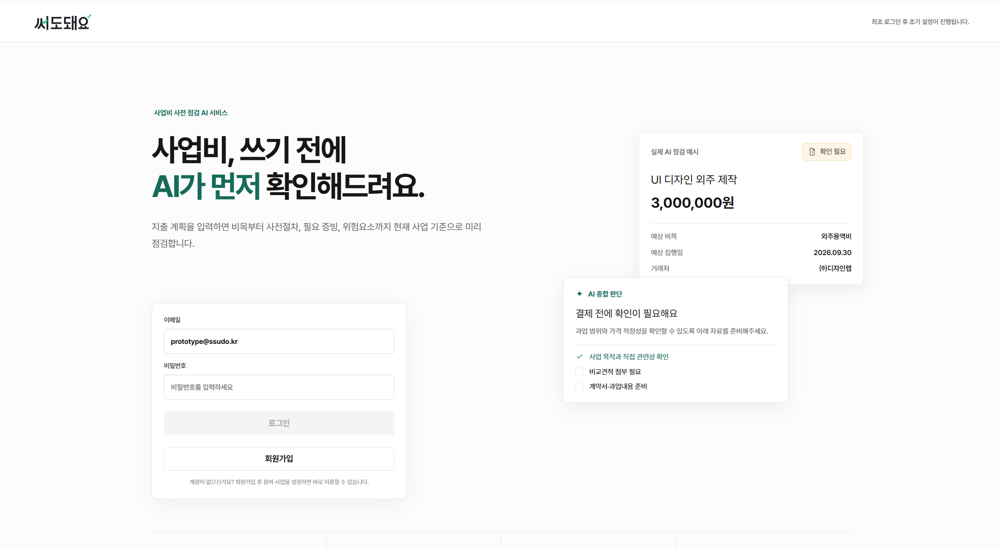

<div align="center">

# 💸 써도돼요

**창업지원금 지출비 사전승인을 근거와 함께 판정하는 AI 서비스**

[](https://www.python.org/)
[](https://fastapi.tiangolo.com/)
[](https://github.com/pgvector/pgvector)
[](docs/8_운영/8-6_NCP_배포.md)
[](https://www.alibabacloud.com/en/product/modelstudio)

[🚀 Demo Version Execution](https://2026-finance-ai-competition-fronten.vercel.app/) · [📘 프로젝트 문서](docs/README.md)

</div>

---

## 📋 목차

1. [프로젝트에 대한 정보](#1-프로젝트에-대한-정보)
2. [시작 가이드](#2-시작-가이드)
3. [기술 스택](#3-기술-스택)
4. [주요 기능](#4-주요-기능)
5. [성능](#5-성능)
6. [프로젝트 구조](#6-프로젝트-구조)
7. [데이터와 활용 한계](#7-데이터와-활용-한계)

---

<a id="1-프로젝트에-대한-정보"></a>
## 1. 📌 프로젝트에 대한 정보

### 프로젝트 소개

창업기업이 "이거 사도 돼요?"를 물으면 중소벤처기업부·창업진흥원·주관기관 규정을 찾아
**가능 · 조건부 · 불가 · 판단불가** 네 가지로 답한다.

근거는 LLM이 새로 쓰지 않고, 검색·룰
조회로 찾은 원문 문장에 번호(S01…)를 매겨 그 번호만 인용한다. 

계산과 효력 판단은 코드가 하고
LLM은 정규화와 최종 조립만 맡아, 판정 1건이 LLM 호출 2~3회로 고정된다.


| 구분 | 내용 |
|---|---|
| 프로젝트명 | 써도돼요 |
| 대상 사업 | 창업진흥원 8종(예비창업패키지·초기창업패키지·창업도약패키지·창업중심대학·재도전성공패키지·초격차 스타트업 프로젝트·TIPS·모두의창업) |
| 판정 결과 | 가능 · 조건부 · 불가 · 판단불가 |
| 배포 주소 | [Vercel 데모](https://2026-finance-ai-competition-fronten.vercel.app/) |
| 구성 | 백엔드 FastAPI + PostgreSQL 17(pgvector) + Caddy, 네이버클라우드 VM 1대에서 Docker Compose 로 운영. 프론트 Vercel(별도 레포) |
| 저장소 | 이 레포(백엔드·수집·평가) |

### 🖥️ 시연 홈화면

<p align="center">
  <a href="https://2026-finance-ai-competition-fronten.vercel.app/">
    
  </a>
</p>

<p align="center"><a href="https://2026-finance-ai-competition-fronten.vercel.app/"><b>브라우저에서 데모 열기</b></a></p>

---

<a id="2-시작-가이드"></a>
## 2. 🚀 시작 가이드

### 로컬 실행

```powershell
# 1) DB
cd db
docker compose up -d
# http://localhost:8081 (pgweb, 로그인 없음) — v_적재현황 이 첫 확인 지점

# 2) 환경변수 — 서버는 프로세스 환경변수만 읽는다(.env 파일을 자동으로 로드하지 않는다)
#    키 목록과 기본값은 .env.example 주석 참조
cd ..
$env:PYTHONIOENCODING = 'utf-8'
$env:DASHSCOPE_API_KEY = '<DashScope API 키>'

# 3) 서버
uvicorn server.main:app --reload
```

### mock 모드

`SUDDOE_MOCK` 을 설정하지 않으면 live 모드(실제 DB·LLM 호출)로 실행된다.
DB·LLM 없이 API 응답 형태만 확인할 때는 `$env:SUDDOE_MOCK = '1'` 을 명시한다.

### 배포

운영 서버는 네이버클라우드(NCP) VM 1대다. API · PostgreSQL · Caddy(HTTPS)를 Docker Compose 로 실행하며
구성 파일은 [`deploy/ncp/`](deploy/ncp/), 전체 절차는 [`docs/8_운영/8-6_NCP_배포.md`](docs/8_운영/8-6_NCP_배포.md)에 있다.

```bash
# 서버에서 (deploy/ncp)
git pull && docker compose up -d --build api
```

로컬에서 이미지를 빌드할 때는 `DOCKER_BUILDKIT=1` 이 필요하다(Dockerfile 의 HF 캐시 마운트).
arm 머신에서는 `--platform linux/amd64` 를 붙인다.

```bash
DOCKER_BUILDKIT=1 docker build -t suddoe-api:local .
```

운영 DB 스키마 변경은 [`db/migrations/`](db/migrations/README.md)의 SQL 을 서버에서 수동으로 적용한다.

### LLM 설정

DashScope Qwen(기본 모델 qwen3.7-plus)을 사용한다.

```dotenv
DASHSCOPE_API_KEY=your_dashscope_api_key_here
SUDDOE_QWEN_MODEL=qwen3.7-plus
```

---

<a id="3-기술-스택"></a>
## 3. ✨ 기술 스택

### Backend

<p>
  
  
  
  
</p>

### Data · Search

<p>
  
  
  
  
</p>

### LLM

<p>
  
</p>

### Infra

<p>
  
  
  
  
  
</p>

---

<a id="4-주요-기능"></a>
## 4. 📍 주요 기능

- **4지 판정** —
- Label 종류: 가능·조건부·불가·판단불가
- 근거 부족 시, "판단 불가"로 판정.
- **근거 인용(S번호)** — LLM은 검색·룰 조회로 찾은 문장 번호만 고르고, 원문·조번호·출처는 코드가 DB에서 가져온다. 
- **체크리스트** — 코드로 "결제 전후 확인 항목"을 조회한 후, 가져온다. 문항 문구 또한 DB에 존재한다.
- **전제 해소** — 판정에 필요한데 아직 없는 사실(F축 데이터)을 짚어 채우게 하거나,
  채울 수 없으면 담당자 문의로 넘긴다.
- **문의초안** — 판단불가일 때 담당자에게 보낼 질문 초안을 작성한다.
- **L3 업로드** — 주관기관 자체 규정(HWP/HWPX/PDF)을 업로드하면 백그라운드에서 파싱·적재하고,
  L1·L2와 함께 판정에 반영한다. 검색하지 않고 기관별로 전체를 읽어 다른 기관 규정과 섞이지 않는다.
  텍스트가 없는 스캔본은 파싱 실패로 처리하고 사유를 알린다.

---

<a id="5-성능"></a>
## 5. 📊 성능

정답셋 342문항(검증 315·채점 분모 320) 전체를 운영 코퍼스(2026-09-07 동기화) 기준으로
채점한 run 206 결과다.

| 축 | 값 |
|---|---:|
| 전체 일치율 | **67.8%**(다수결 기준선 57.8%, +10.0%p) |
| 세트별 일치율 | 적대적 96.3 · 공식 70.0 · 본세트 69.3 · 공통 68.2 · L3 55.6 · 보강 25.0 |
| 정답유형별 일치율 | 불가 85.9 · 조건부 69.4 · 가능 14.3 · 판단불가 9.5 |
| 인용 정확도 / 근거 도달률 | 63.9% / 63.2% |
| 안전 지표(정답이 불가인 문항을 가능으로 답한 수) | **0 / 320** |
| 전수 평가 1회 비용 | $2.92(문항당 약 12원) |
| 판정 지연 | 1건 약 60초(정규화 4초 + 판정 55~59초) |

안전 지표는 정답이 `불가`인 문항만 센 값이다. 정답이 `가능`이 아닌 모든 문항(조건부·판단불가 포함)에서
`가능`으로 답한 수는 판정 파이프라인 평가(`scripts/eval_e2e.py`)의 치명 오답 지표로 따로 집계한다.

프롬프팅의 개선으로 판정성능을 높일 여지가 존재한다는 점을 파악한 상태이다.
[`docs/제출_공모전_설명.md`](docs/제출_공모전_설명.md).

---

<a id="6-프로젝트-구조"></a>
## 6. 🗂️ 프로젝트 구조

```text
server/                          FastAPI 앱 — 라우트·인증·판정 파이프라인 진입점
scripts/                         정규화·검색·룰조회·판정·검증·L3 파싱·수집 파이프라인
db/init/                         스키마·RLS·권한 SQL (빈 볼륨에서 docker compose 가 실행)
db/migrations/                   운영 DB 에 수동으로 적용하는 날짜별 변경 SQL
db/seed/                         기관 명부 적재 후 수동으로 실행하는 데이터 보정 SQL
deploy/ncp/                      운영 배포 구성 (Docker Compose · Caddy · 백업/복원 스크립트)
docs/                            설계·운영 문서 (docs/README.md 가 지도)
2026_Finance_DATA_FOR_RAG/       원본 규정·PMS 문서 및 데이터셋 구조 설명
법령 PDF/                        L1(중기부 법령) 원본 PDF
_hwp변환/                        HWP 원본을 변환한 중간 산출물
Dockerfile                       API 컨테이너 빌드(FastAPI + KURE-v1 CPU 임베딩)
requirements-api.txt             API 컨테이너 의존성 (torch CPU 휠 고정 등)
.env.example                     환경변수 목록과 기본값 (운영 값은 deploy/ncp/.env)
```

---

<a id="7-데이터와-활용-한계"></a>
## 7. 데이터와 활용 한계

지금 코퍼스(2026-09-07 기준):

| 항목 | 값 |
|---|---|
| 문서 | 283 (활성 245) |
| 검색 청크 | 20,648 |
| 조문 간 참조 | 44,865 |
| 룰 | 82행(금지예시 358 · 허용예시 225, 전부 verified) |
| 체크항목 | 52 |
| 비목 | 창업 10 · RND(TIPS) 8 · 별칭 326 |
| 정답셋 | 342문항(검증 315 · 채점 분모 320) |
| L3(업로드분) | 224조각 |

규범은 세 층으로 관리한다.

- **L1 중소벤처기업부** — 법률·고시·훈령·통합관리지침. 우리가 조달한다.
- **L2 창업진흥원** — 사업별 세부관리기준. 우리가 조달한다.
- **L3 주관기관** — 기관 규정·협약 특약. 사용자가 업로드한다.


- L3 데이터셋의 수집 한계로 인하여, 정확한 판정률을 일컫긴 무리가 존재한다.

더 자세한 판정 흐름·배포 구조는 [`docs/README.md`](docs/README.md)와
[`docs/제출_공모전_설명.md`](docs/제출_공모전_설명.md)를 확인한다.
</content>
